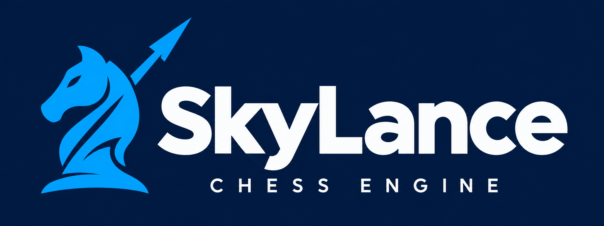

# SkyLance

SkyLance is a C++20 UCI chess engine by **Aurentium Technologies**. This repository contains its three- through five-piece endgame reader, original engine integration, focused tests and research documentation. Development began under the Orient working name.

## Overview

SkyLance runs locally and connects to chess GUIs through UCI. The default build uses classical evaluation, one search thread and portable CPU settings. It requires no network weights, account or online service. Optional Syzygy tables provide solved endgame information; without them, the engine uses ordinary search.

The retained reader enables the prefix accelerator and adaptive material catalogue. The rejected fixed five-piece catalogue and diagnostic instrumentation remain disabled. No engine-strength rating is claimed.

## Build

Requirements: CMake 3.20+, a C++20 compiler, Python 3.10+ for the default test build, and standard threading support. The current implementation has been built and tested on Linux with GNU C++ 13.3.0.

```sh
git clone https://github.com/Aurentium-Technologies/SkyLance_Endgame.git
cd SkyLance_Endgame
cmake -S orient-endgame-component -B build -DCMAKE_BUILD_TYPE=Release -DORIENT_NATIVE=OFF
cmake --build build --parallel 2
./build/skylance --version
```

`ORIENT_NATIVE=OFF` keeps the binary portable across compatible CPUs. Build locally for your platform; this repository does not require prebuilt executables.

## Run

Add `build/skylance` to your chess GUI as a UCI engine, or start it directly:

```sh
./build/skylance
```

The executable reads UCI commands from standard input and writes responses to standard output. For a quick interactive check, enter:

```text
uci
isready
position startpos
go depth 4
```

Enter `quit` to exit. To install the public executable in a local prefix:

```sh
cmake --install build --prefix "$HOME/.local"
```

This installs `bin/skylance`. The historical `orient` build target remains available for research scripts; both executable names identify as SkyLance. Internal `orient` namespaces, CMake options and the existing network-file format retain compatibility.

## Optional tablebases

**Table files are not uploaded to this repository.** Validation used the complete standard-chess **Syzygy three- through five-piece collection**, including both kings: **145 WDL files (`.rtbw`) and 145 DTZ files (`.rtbz`), totalling 983,957,920 bytes** (about 984 MB).

The tested collection came from these Lichess-hosted sources:

- [Three- through five-piece WDL tables](https://tablebase.lichess.ovh/tables/standard/3-4-5-wdl/).
- [Three- through five-piece DTZ tables](https://tablebase.lichess.ovh/tables/standard/3-4-5-dtz/).
- [Publisher SHA-256 checksums](https://tablebase.lichess.ovh/tables/standard/sha256) and [file sizes](https://tablebase.lichess.ovh/tables/standard/bytes.tsv).

The small [pinned table catalogue](orient-endgame-component/tools/syzygy345.json) is included in Git. It records every filename, download URL, byte size and SHA-256 used to identify the tested dataset; it contains no table data. The downloader checks downloaded files against those pinned values.

From the repository root, download the collection separately:

```sh
python3 orient-endgame-component/tools/download_tablebases.py
```

The default destination is `orient-endgame-component/external/tablebases/syzygy/3-4-5/`, which is excluded from Git. Configure your GUI's `SyzygyPath` option to that directory's absolute path. To recheck an existing download without fetching files:

```sh
python3 orient-endgame-component/tools/download_tablebases.py --verify-only
```

## Test

Run the source-only checks after building:

```sh
ctest --test-dir build --output-on-failure --parallel 2
```

Without downloaded tables, four table-dependent CTest groups report a skip. A prepared-game-fixture unit check also skips its local archival dataset when absent.

To include the real-table checks:

```sh
ORIENT_SYZYGY_PATH="$PWD/orient-endgame-component/external/tablebases/syzygy/3-4-5" \
  ctest --test-dir build --output-on-failure --parallel 2
```

For Python test discovery with the current built referee and table collection:

```sh
ORIENT_REFEREE_BINARY="$PWD/build/orient-endgame-referee" \
ORIENT_SYZYGY_PATH="$PWD/orient-endgame-component/external/tablebases/syzygy/3-4-5" \
  python3 -m unittest discover -s orient-endgame-component/tests -p 'test_*.py'
```

The [30 October 2026 pre-upload review](orient-endgame-component/docs/preupload-review-2026-10-30.md) records **24/24 CTest groups** and **132 Python tests** passing with the local tables. An independent source-only build passed 20 CTest groups with four table-dependent skips. Focused ASan/UBSan checks also passed; the report describes their scope and limits. The [GitHub workflow](.github/workflows/ci.yml) builds, runs source-only checks, installs the engine and verifies the branding checksums.

## Repository contents and documentation

The repository includes engine and reader source, build configuration, tests, developer tools, branding, licences, public reports and small provenance/checksum records. It includes the maintained Fathom reader and its unchanged upstream comparison copy.

Downloaded table files, build trees, compiler caches, frozen checkpoints and raw investigation artifacts remain outside Git. Optional external comparator checkouts are referenced through the research documentation and retained client configuration. Historical reports may link to raw evidence available only in the original local research workspace; those artifacts are not downloadable from this repository. Their measurements describe frozen experiments, not a new benchmark of the current fixes.

`BUNDLE-MANIFEST.json` describes the original transfer archive. It is retained as provenance and is not a checksum manifest for this edited source checkout.

- [Component README](orient-endgame-component/README.md)
- [Build and continuation handoff](orient-endgame-component/HANDOFF.md)
- [Pre-upload review and bug fixes](orient-endgame-component/docs/preupload-review-2026-10-30.md)
- [Retained endgame improvements 007](orient-endgame-component/docs/endgame-improvements-007.md)
- [Branding guide](assets/branding/README.md)

## Licence and attribution

The engine code uses the [MIT licence](LICENSE), with original notices retained. The Syzygy reader is a maintained [Fathom fork](orient-endgame-component/third_party/fathom/ORIENT.md), whose [MIT licence](orient-endgame-component/third_party/fathom/LICENSE), upstream pin, local patches and attribution are included.

The optional standalone Rust comparison client has separate GPL terms and is not linked into the C++ engine. See [third-party notices](THIRD_PARTY_NOTICES.md) for the reader, research comparators and table-source attribution.
